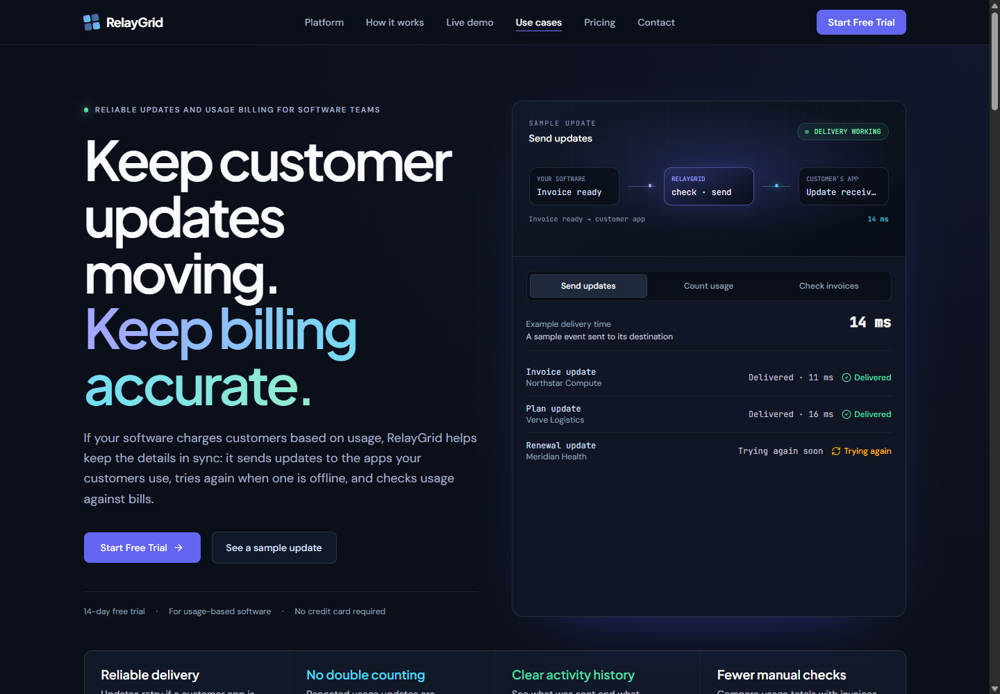
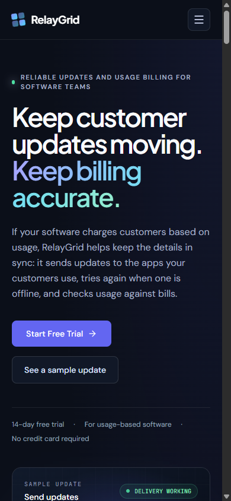

# RelayGrid

**Reliable customer updates. Accurate usage bills.**

RelayGrid is a landing page and interactive product concept for teams that send customer notifications and need a clear view of delivery, usage, and billing. It brings the customer-facing story of a complex workflow into a straightforward, approachable experience.

## Live demo

_Deployment link will be added after the Vercel deployment is published._

## Product experience

- Explore a product overview that explains how customer updates move through RelayGrid.
- Try the sample workspace: search updates, filter by status, inspect activity, retry a delivery, review a billing difference, and reset the demo data.
- Adjust example retry policies, event volumes, and deployment regions in the feature panels.
- Compare plans and explore the selected plan in the trial modal.
- Submit the demo request form to see its validation and confirmation state.

The workspace and form run entirely in the browser with sample data. Form submissions are not sent to a server or saved.

## Built with

- React 19 and JavaScript (JSX)
- Vite 8
- Tailwind CSS 4
- Motion for React
- Lucide React

## Run locally

**Requirements:** Node.js 20.19+ or 22.12+.

```bash
npm install
npm run dev
```

Open the local URL printed by Vite (by default, <http://localhost:3000>).

## Available scripts

| Command | Description |
| --- | --- |
| `npm run dev` | Start the local development server |
| `npm run build` | Create the production build in `dist/` |
| `npm run preview` | Preview the production build locally |

## Deploy

The project is ready for Vercel or Netlify:

1. Import the GitHub repository into the hosting provider.
2. Select the Vite framework preset.
3. Use `npm run build` as the build command and `dist` as the output directory.
4. Deploy. No environment variables or backend services are required.

## Screenshots

### Desktop



### Mobile



## Design notes

- The product story focuses on a practical customer problem: making notifications dependable and usage easier to understand.
- A dark ink-and-indigo palette, restrained cyan highlights, and editorial typography give the interface a distinctive but approachable feel.
- The hero visual illustrates the product workflow instead of relying on a decorative background or a generic dashboard mockup.
- Interactive examples let visitors explore delivery status, usage totals, and review actions directly.
- Separate product, process, pricing, and contact sections guide visitors from understanding the problem to evaluating the product.
- Responsive layouts, keyboard focus states, and reduced-motion support keep the visual design accessible and usable.
